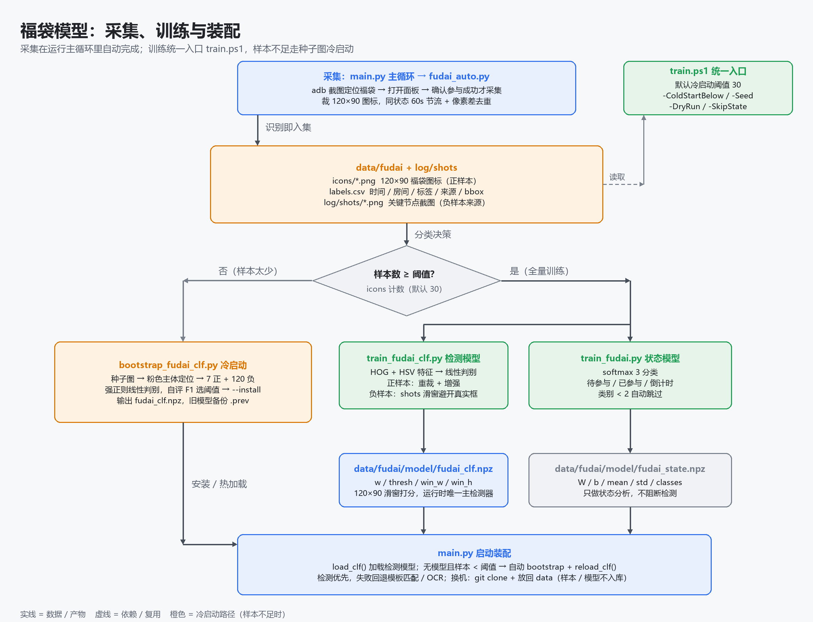
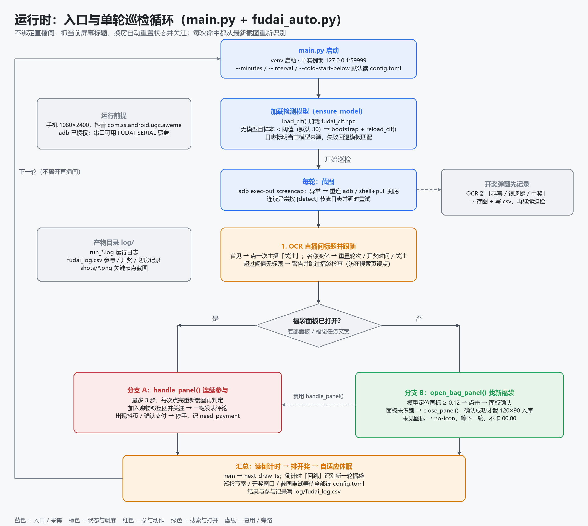

# 抖音直播间福袋自动蹲守

通过 adb 控制真机，识别直播间左上角福袋浮标，自动完成任务并等待开奖。**不绑定具体直播间**，自动跟随当前屏幕上的直播间。

## 依赖

- Python 3.11+（已在 3.13 验证；`config.toml` 用标准库 `tomllib`）
- adb 已连接手机，`adb devices` 能看到设备
- Python 包见 `requirements.txt`

```powershell
python -m venv .venv
.venv\Scripts\python.exe -m pip install -r requirements.txt
```

## 运行

```powershell
.venv\Scripts\python.exe main.py --minutes 180 --interval 30
```

| 参数 | 默认 | 说明 |
|---|---|---|
| `--minutes` | 180 | 运行时长（分钟），取自 `config.toml [run].minutes` |
| `--interval` | 60 | 基础巡检间隔（秒），取自 `[run].interval`；剩余时间久时会自动放慢 |
| `--room` | 空 | 可选：期望的房间标题关键字；留空则只跟随当前直播间 |
| `--serial` | IB8XCEM7IJBAMZY5 | adb 设备序列号（也可用环境变量 `FUDAI_SERIAL`） |
| `--cold-start-below` | 30 | 样本数低于该值时冷启动，取自 `[cold_start].below` |

命令行显式传参时覆盖 `config.toml`，`config.toml` 覆盖代码内置默认值。

## 配置 config.toml

检测节奏、开奖观察、采样节流都集中在根目录 `config.toml`，改完直接重启 `main.py` 生效（无需改代码）。时间单位统一为秒。

| 段 | 键 | 默认 | 说明 |
|---|---|---|---|
| `[run]` | `minutes` | 180 | 运行时长（分钟） |
| | `interval` | 60 | 基础巡检间隔 |
| `[cold_start]` | `below` | 30 | 样本数低于该值走种子图 bootstrap |
| `[detect]` | `shot_retry_seconds` | 10 | 截图异常后的重试等待 |
| | `shot_error_log_every_seconds` | 30 | 连续截图异常的日志节流 |
| | `room_check_seconds` | 5 | 直播间标题巡房间隔（只认房间，不点福袋） |
| | `room_similarity` | 0.86 | 标题相似度≥该值视为同一房间，防 OCR 尾字抖动误切房 |
| | `room_switch_settle_seconds` | 2 | 切房后等待再截图/关注 |
| | `room_missing_warn_seconds` | 180 | 连续多久没标题就警告 |
| | `default_draw_seconds` | 750 | 读不到倒计时的默认排期 |
| | `new_cycle_jump_seconds` | 90 | 倒计时回跳多少秒算新一轮 |
| | `watch_seconds` | 90 | 开奖观察窗口时长 |
| | `draw_margin_seconds` | 3 | 提前多少秒进观察窗口 |
| | `panel_settle_seconds` | 1 | 面板处理后的隔拍 |
| `[pacing]` | `slow_remaining_seconds` / `slow_interval` | 600 / 180 | 剩余 >10 分钟时的巡检间隔 |
| | `mid_remaining_seconds` / `mid_interval` | 240 / 90 | 剩余 >4 分钟时的巡检间隔 |
| | `near_min_seconds` | 20 | 临近开奖的下限间隔 |
| | `min_sleep_seconds` | 1.5 | 每轮最短休眠 |
| `[sample]` | `throttle_seconds` | 60 | 同状态样本采集节流 |
| `[watch]` | `poll_seconds` | 3 | 开奖窗口内截图/识别间隔 |
| | `log_every_seconds` | 20 | “等待开奖中”日志节流 |

配置写错或未知键会在启动时打印 `[config]` 提示，并回落到内置默认值。

巡房与福袋检测是分开的：每 `room_check_seconds`（默认 5 秒）截图 + OCR 标题，切房后立即重置并关注；点福袋仍按 `interval` 和 `[pacing]` 的节奏，不会因为巡房变快而频繁点开面板。

## 训练

除采集外的全部训练都走 `train.ps1`，一条命令跑完两个模型并打印产物：

```powershell
.\train.ps1                          # 样本 ≥30 全量训练；<30 自动冷启动（种子图 bootstrap）
.\train.ps1 -ColdStartBelow 20       # 自定义冷启动阈值
.\train.ps1 -Seed data\fudai\seed\seed_vgn.png  # 指定种子图
.\train.ps1 -DryRun                  # 两个都只评估，不写任何文件
.\train.ps1 -SkipState               # 只训检测模型
.\train.ps1 -SkipDetector            # 只训状态模型
.\train.ps1 -Aug 16 -Epochs 800      # 状态模型增强/轮数
.\train.ps1 -Predict data\fudai\icons # 用状态模型预测图片/目录
.\train.ps1 -Watch -IntervalSec 300  # 样本数变化自动全量重训（常驻）
```

冷启动逻辑：`data/fudai/icons` 里的样本数 < `-ColdStartBelow`（默认 30）时，检测模型改为用一张种子图 bootstrap（`bootstrap_fudai_clf.py`），只做“点火”；样本涨到阈值后再跑全量训练。状态模型要求至少 2 个类别，冷启动阶段会自动跳过。`main.py` 启动时读 `config.toml [cold_start].below`（默认 30）做同样判断：没有检测模型且样本不足，会先 bootstrap 再热加载。`train.ps1` 的 `-ColdStartBelow` 是独立参数，改阈值时两边保持一致。

| 文件 | 用途 | 训练脚本 |
|---|---|---|
| `data\fudai\model\fudai_clf.npz` | 运行时检测福袋位置（`w/thresh/win_w/win_h`） | `train_fudai_clf.py` 或 `bootstrap_fudai_clf.py` |
| `data\fudai\model\fudai_state.npz` | 3 分类状态（待参与/已参与/倒计时），只做分析 | `train_fudai.py` |

重训后下次启动 `main.py` 时加载新权重；冷启动路径会当场调用 `reload_clf()` 热加载。

## 换机复现

仓库里只放代码、模板图和文档。`data/fudai/icons`、`labels.csv`、`seed/`、`model/` 都在 `.gitignore` 里，**本机训练产物不提交**，所以换机后有两种恢复方式：

```powershell
git clone git@github.com:i314q159/fudai_auto.git
cd fudai_auto
python -m venv .venv
.venv\Scripts\python.exe -m pip install -r requirements.txt
adb devices                       # 确认设备已授权
```

- **只要流程能跑**：直接启动 `main.py`。检测模型缺失且样本 <30 时，会自动找 `data/fudai/seed/` 下的种子图做 bootstrap；没有种子图会在日志里明确报错。
- **要接着原来的数据练**：把旧机器的整个 `data/fudai/` 拷过来（icons、labels.csv、seed、model 一起），再按需跑 `.\train.ps1`。
- 手机换了：`--serial` 或环境变量 `FUDAI_SERIAL` 覆盖；分辨率仍按 1080×2400 的 ROI 设计，换分辨率要改 `fudai_auto.py` 顶部 ROI。

## 流程图

采集 → 训练（冷启动 / 全量）→ 模型装配：



`main.py` 入口与单轮巡检循环：



图片由 `docs/make_flowchart.py` 生成（PIL + 微软雅黑），流程变了重跑一次脚本即可更新。

## 工作机制

1. 每轮截图，先 OCR 直播间标题：首见点一次主播「关注」；切房记 `直播间切换: A -> B`，重置轮次/开奖时间/关注状态继续蹲；连续 3 分钟无标题会警告并跳过福袋检查。
2. 面板已打开则直接处理任务；否则在左上角定位福袋浮标：优先用 `fudai_clf.npz`（HOG+颜色直方图线性分类器）滑窗打分，命中分 ≥0.12 即视为福袋；模型缺失/打分失败回退模板匹配、OCR 倒计时反推。
3. 打开福袋面板后最多连点 3 步，每步都重新截图再判定：
   - 出现「一键发表评论」→ 点击完成福袋任务
   - 出现「加入购物粉丝团并关注主播」→ 点击加入粉丝团并关注，成功后同面板继续点「一键发表评论」，一次完成两步任务
   - 出现抖币/支付确认 → 不自动支付，记 `need_payment` 并停手
   - 显示「任务已完成 等待开奖」→ 已参与，关闭面板继续
4. 只有面板确认参与成功才裁 120×90 图标入训练集，防止误检污染数据。
5. 读面板倒计时排开奖时间；倒计时“回跳”识别新一轮福袋；临近开奖进 90 秒观察窗口，识别「中奖 / 未中奖」并记录。
6. 自适应节奏：剩余 >10 分钟每 3 分钟查一次，>4 分钟每 90 秒，临近开奖加密到 30 秒内，并保证不越过开奖时刻。
7. 常亮保护：脚本外已设置 `screen_off_timeout` 最大、`stay_on_while_plugged_in`；截图失败会自动重连 adb、重启 adb server、退回 shell+pull。

## 目录与输出

```
main.py              运行入口：CLI / 单实例锁 / 冷启动判断 / 主循环
fudai_auto.py        底层能力库：截图、OCR、定位、面板、采集、watch_result
fudai_feat.py        HOG+HSV 特征与滑窗打分，训练/推理共用
bootstrap_fudai_clf.py  一张种子图冷启动 -> fudai_clf.npz
train_fudai_clf.py   检测模型训练 -> data/fudai/model/fudai_clf.npz
train_fudai.py       状态模型训练（3 分类 + LOO 评估）-> fudai_state.npz
train.ps1            一键训练/预测/常驻重训（含冷启动阈值）
data/fudai/bag_template.png  福袋图标模板（模型缺失时兜底，已入库）
requirements.txt     依赖
config.toml          检测节奏/开奖观察/采样节流配置（CLI 可覆盖）
log/                 运行日志与截图
log/run_*.log        每次运行的文本日志
log/fudai_log.csv    参与/切房/开奖结果记录
log/shots/           关键节点截图（同时作为检测模型负样本来源）
data/fudai/          福袋识别训练集（本机产物，不入库）
data/fudai/icons/    图标样本 png（120x90，以福袋主体为中心）
data/fudai/labels.csv 样本标注（时间/直播间/标签/来源/bbox）
data/fudai/seed/     冷启动种子图（不入库）
data/fudai/model/    检测/状态模型与训练报告（不入库）
docs/make_flowchart.py            流程图生成脚本（PIL）
docs/pipeline.png                 采集 / 训练 / 装配图
docs/runtime_loop.png             运行时入口与循环图
.venv/               虚拟环境
```

样本采集规则：同一状态（待参与/已参与/倒计时）60 秒内只存一张，并对像素做去重；标签取图标下方 OCR 文字（待参与、已参与或倒计时）。

重新训练优先用 `.\train.ps1`（自动汇总样本与负样本、生成报告）；脚本内部等价于分别跑 `train_fudai_clf.py` 和 `train_fudai.py`。样本多了以后重训即可，重启 `main.py` 自动加载新模型。

## 注意

- 参与福袋可能要求发送直播间指定评论，脚本只点「一键发表评论」，不输入自定义文本。
- 「加入购物粉丝团并关注主播」属正常福袋任务，实测免费（无支付确认）；一旦弹出抖币/支付界面脚本不会确认，只在 `log/fudai_log.csv` 记 `need_payment`。
- 必须停留在直播间：开奖前离开会失去资格，脚本不会点关闭/返回。
- 单实例锁：脚本占用本地 59999 端口，重复启动会直接退出。
